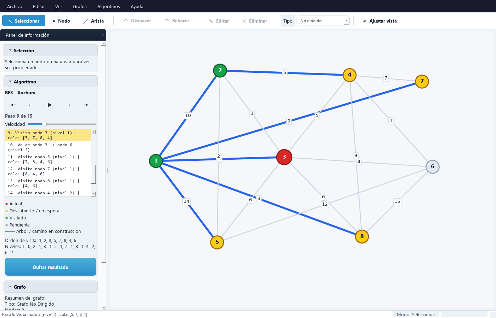

# Graficador de Recorridos

Aplicación de escritorio para construir grafos de forma visual y ejecutar sobre ellos algoritmos clásicos (recorridos, caminos mínimos, árboles de expansión mínima y análisis estructural), con **visualización paso a paso** de cada ejecución.

Pensada como herramienta de apoyo para el estudio de Análisis y Diseño de Algoritmos: permite ver cómo avanza cada algoritmo, qué decisiones toma y por qué llega a su resultado.



## Características

**Edición de grafos**
- Grafos dirigidos y no dirigidos con aristas ponderadas. Se puede convertir uno en otro sin perder el trabajo.
- Creación de nodos y aristas con el mouse, mediante tres modos de edición: Seleccionar, Nodo y Arista.
- Menú contextual sobre nodos, aristas y fondo. Doble clic sobre una arista para editar su peso.
- Selección múltiple, arrastre de nodos, zoom y desplazamiento de la vista.
- Deshacer y rehacer de todas las ediciones.

**Algoritmos**
- Recorridos: BFS y DFS, con niveles, tiempos de descubrimiento/finalización y clasificación de aristas.
- Caminos mínimos: Dijkstra, con nodo destino opcional, y Bellman-Ford, con detección de ciclos negativos.
- Árbol de expansión mínima: Kruskal y Prim. Si el grafo no es conexo, el resultado es un bosque.
- Análisis: orden topológico, detección de ciclos, componentes fuertemente conexas y centralidad de grado.

**Visualización paso a paso**
- Reproductor para avanzar, retroceder, saltar a cualquier paso o reproducir la ejecución completa a distintas velocidades.
- Nodos y aristas coloreados según su estado: actual, en espera, visitado, finalizado, árbol, candidata, descartada o resultado.
- Leyenda que muestra solo los estados presentes en cada paso.

**Archivos**
- Guardado y apertura de grafos en formato JSON, con aviso de cambios sin guardar.
- Exportación del grafo como imagen PNG y del resumen de métricas como texto.

## Requisitos

- Python 3.10 o superior
- PyQt6, networkx y matplotlib (se instalan desde `requirements.txt`)

## Instalación

```bash
git clone https://github.com/AcuLuis/Graficador-Recorridos.git
cd Graficador-Recorridos
```

Opcionalmente, crea un entorno virtual:

```bash
python -m venv .venv
.venv\Scripts\activate        # Windows
source .venv/bin/activate     # Linux / macOS
```

Instala las dependencias:

```bash
pip install -r requirements.txt
```

## Ejecución

```bash
python MainFinal.py
```

Para empezar con un ejemplo, abre **Grafos › Cargar Grafo de Prueba**.

## Uso

### Modos de edición

| Modo | Tecla | Acción |
|---|---|---|
| Seleccionar | `V` | Clic para seleccionar. `Ctrl`/`Shift` + clic agrega a la selección. Arrastra un nodo para moverlo o el fondo para desplazar la vista. |
| Nodo | `N` | Clic en un espacio vacío para crear un nodo. |
| Arista | `E` | Clic en el nodo origen y luego en el destino; se solicita el peso. |

### Ejecutar un algoritmo

Hay dos formas de ejecutar un algoritmo:

- Desde el menú **Algoritmos**.
- Con **clic derecho sobre un nodo › Ejecutar desde el nodo**, que lo usa como nodo de inicio.

Al terminar se muestra el resultado final. En el panel **Algoritmo** puedes recorrer la ejecución:

| Control | Acción |
|---|---|
| ⇤ | Ir al inicio, antes del primer paso |
| ← / → | Paso anterior / siguiente |
| ▶ / ❚❚ | Reproducir o pausar |
| ⇥ | Ir al resultado final |

También puedes hacer clic en cualquier paso de la lista para saltar a él.

### Atajos de teclado

| Atajo | Acción |
|---|---|
| `Ctrl+N` / `Ctrl+O` | Nuevo grafo / abrir |
| `Ctrl+S` / `Ctrl+Shift+S` | Guardar / guardar como |
| `Ctrl+I` | Exportar imagen |
| `Ctrl+Z` / `Ctrl+Y` | Deshacer / rehacer |
| `Supr` / `Retroceso` | Eliminar la selección |
| `F2` | Editar el nodo o la arista seleccionada |
| `Esc` | Cancelar la acción en curso |
| `F` | Ajustar la vista al grafo |
| `Ctrl++` / `Ctrl+-` / `Ctrl+0` | Acercar / alejar / restaurar vista |
| `Ctrl+P` | Mostrar u ocultar el panel de información |
| `F1` | Ayuda |

La rueda del mouse hace zoom y el botón central desplaza la vista.

## Algoritmos disponibles

| Algoritmo | Tipo de grafo | Notas |
|---|---|---|
| BFS | Ambos | Orden de visita, nivel de cada nodo y estado de la cola. |
| DFS | Ambos | Iterativo. Tiempos de descubrimiento/finalización y aristas de árbol, retroceso, avance y cruce. |
| Dijkstra | Ambos | No admite pesos negativos. Destino opcional para resaltar un único camino. |
| Bellman-Ford | Ambos | Admite pesos negativos y detecta ciclos negativos. |
| Kruskal | No dirigido | Muestra las aristas descartadas por formar ciclo. |
| Prim | No dirigido | Parte del nodo elegido. Si el grafo no es conexo, continúa en cada componente. |
| Orden topológico | Dirigido | Algoritmo de Kahn. Informa si el grafo tiene ciclos. |
| Detección de ciclos | Ambos | Resalta un ciclo si existe. |
| Componentes fuertemente conexas | Dirigido | Lista cada componente y resalta sus aristas internas. |
| Centralidad de grado | Ambos | El tamaño de cada nodo es proporcional a su centralidad. |

Los recorridos visitan los vecinos en orden ascendente, así que los resultados son reproducibles.

## Formato de archivo

Los grafos se guardan en JSON:

```json
{
  "nodes": [1, 2, 3],
  "edges": [
    [1, 2, {"weight": 4}],
    [2, 3, {"weight": 1}]
  ],
  "pos": {
    "1": [0.2, 0.5],
    "2": [0.5, 0.8],
    "3": [0.8, 0.5]
  },
  "graph_type": "Undirected"
}
```

- `nodes`: identificadores enteros de los nodos.
- `edges`: `[origen, destino]` o `[origen, destino, {"weight": peso}]`. El peso por defecto es 1.
- `pos`: posición de cada nodo en el lienzo, entre 0 y 1. Es opcional: los nodos sin posición se ubican automáticamente.
- `graph_type`: `"Undirected"` o `"Directed"`.

[`datos_prueba.json`](datos_prueba.json) contiene un ejemplo completo.

## Estructura del proyecto

```
├── MainFinal.py          Punto de entrada
├── core/                 Lógica sin dependencias de interfaz
│   ├── graph_model.py    Modelo del grafo y serialización
│   ├── graph_service.py  Lectura, validación y escritura de archivos
│   ├── algorithms.py     Algoritmos con registro de pasos
│   ├── step_state.py     Estado visual de un algoritmo en cada paso
│   ├── graph_stats.py    Métricas del grafo
│   └── history.py        Pilas de deshacer y rehacer
├── ui/                   Interfaz (PyQt6 + matplotlib)
│   ├── main_window.py    Ventana principal, menús y barra de herramientas
│   ├── canvas.py         Lienzo: dibujo e interacción con el mouse
│   ├── info_panel.py     Panel lateral
│   ├── player.py         Reproductor de pasos
│   ├── dialogs.py        Diálogos de entrada de datos
│   ├── theme.py          Paleta de colores
│   └── styles.py         Hoja de estilos de la aplicación
├── tests/                Pruebas automatizadas
└── datos_prueba.json     Grafo de ejemplo
```

## Pruebas

```bash
python -m unittest
```

Las pruebas de interfaz se ejecutan sin abrir ventanas, con Qt en modo `offscreen`.

## Contribuciones

Las sugerencias y mejoras son bienvenidas. Puedes abrir un *issue* para reportar un problema o proponer una idea, o enviar un *pull request* con tus cambios. Antes de enviarlo, verifica que las pruebas pasen con `python -m unittest`.

## Licencia

Este proyecto se distribuye bajo la [licencia MIT](LICENSE): puedes usarlo, copiarlo, modificarlo y distribuirlo libremente, también con fines comerciales, siempre que conserves el aviso de copyright.

## Autor

Luis Antonio Acuña Ayala ([@AcuLuis](https://github.com/AcuLuis))
